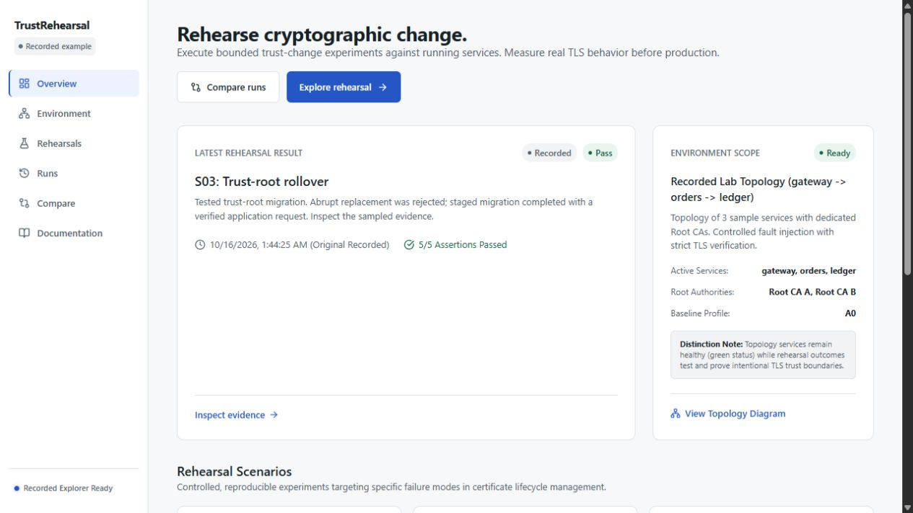
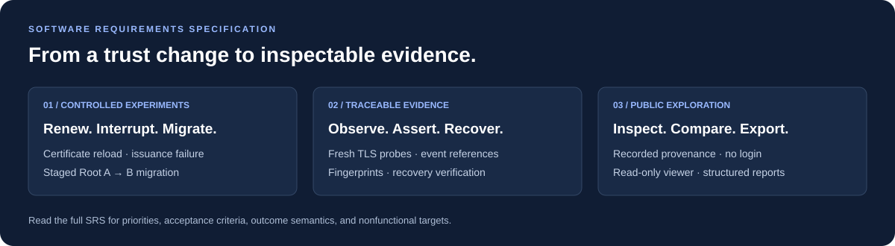
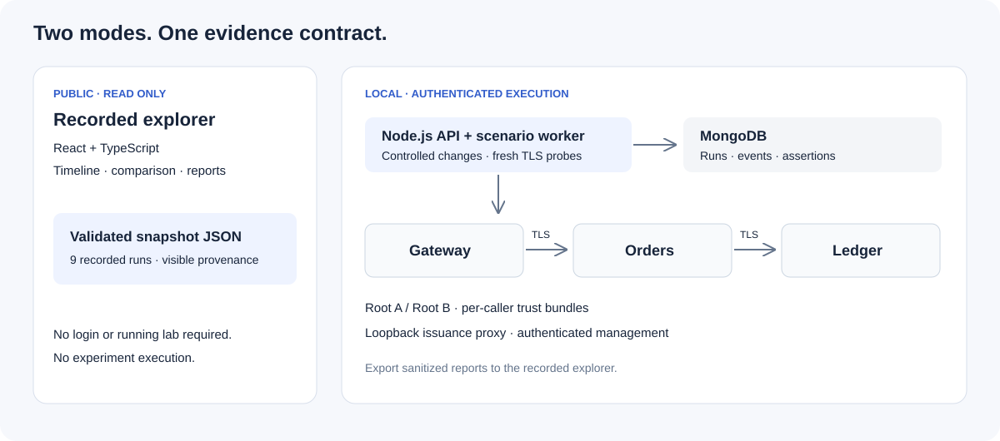

<div align="center">

# TrustRehearsal

### Rehearse cryptographic change. See what breaks before production.

**A certificate can renew successfully while your application still serves the old one. Prove the change reached the connection.**

Certificate lifecycle resilience · Real TLS evidence · Credential-free recorded explorer

[Read the SRS](docs/02-srs.md) · [Architecture](docs/04-architecture.md) · [Explore the scenarios](#three-changes-worth-rehearsing) · [Run the demo](#open-the-recorded-demo)

</div>



*Actual application screenshot. The public explorer displays recorded lab evidence; it does not execute live experiments.*

## Requirements and engineering documents

[](docs/02-srs.md)

**[Read the full Software Requirements Specification →](docs/02-srs.md)**

| Document | What it covers |
| --- | --- |
| [Software requirements specification](docs/02-srs.md) | Functional requirements, priorities, acceptance evidence, nonfunctional targets, and outcome semantics. |
| [System architecture](docs/04-architecture.md) | Component boundaries, service topology, and execution design. |
| [Scenario specification](docs/06-scenarios.md) | Certificate renewal, issuance failure, and trust-root migration experiments. |
| [Security model](docs/08-security.md) | Operator authentication, lab isolation, key handling, and public viewer boundaries. |
| [Verification and progress](docs/PROGRESS.md) | Observed checks, implementation decisions, and remaining limitations. |

The SRS records design requirements and acceptance targets. Check the verification and progress records for what has actually been demonstrated; some production-hardening targets remain open.

## Why it exists

Issuing a certificate is one step. Installing it, reloading the application, updating caller trust, and proving that dependent services still communicate are separate steps—and each can fail independently.

TrustRehearsal explores that gap with bounded experiments against a small HTTPS service chain. It captures fresh TLS handshakes, certificate fingerprints, expected trust rejections, application requests, and recovery evidence, then makes those observations inspectable in a browser.

The question is practical: **“If we change this certificate or trust root, what will our callers actually experience?”**

## Three changes worth rehearsing

| Rehearsal | What changes | What the evidence demonstrates |
| --- | --- | --- |
| **S01 · Renewal without reload** | Install a renewed certificate while the process retains its previous TLS context. | The on-disk and served fingerprints differ; reloading the context makes the renewed certificate visible to fresh connections. |
| **S02 · Issuance-path failure** | Make the controlled loopback CA issuance proxy return HTTP 502. | Renewal fails through an actual HTTP request while sampled application traffic continues using its existing valid certificates. |
| **S03 · Trust-root rollover** | Compare abrupt Root A → B replacement with a staged migration. | An A-only caller rejects B; dual trust permits migration of the service chain; a final application request succeeds after A is pruned. |

An expected TLS rejection can be a **passing assertion**. The rehearsal outcome and the service's health answer different questions. Successful samples describe the measured lab window, not a guarantee of uninterrupted production traffic.

## Follow the evidence in two minutes

1. Open **Overview** and choose **Inspect evidence** on the latest recorded result.
2. Read the assertions, then inspect the timeline for TLS probes, fingerprints, and application requests.
3. Open the report to see the recorded measurement scope and recovery result; download the JSON for the underlying structured report.
4. Use **Compare** to inspect compatible runs of the same scenario.

The default public experience needs **no account, password, MongoDB, backend, or running lab**. Nine recorded runs—three per scenario—ship with the repository. Their recorded provenance stays visible throughout the explorer.

## How it works



The React viewer reads exported snapshots and validates embedded reports with the shared Zod contract. Its adapter rejects writes. The local Node.js lab provides controlled certificate profiles, authenticated management endpoints, an issuance proxy, and a worker that records scenario events in MongoDB.

Application traffic follows `gateway → orders → ledger`, with server-certificate and hostname verification on outbound HTTPS connections. Each caller has its own trust configuration, so a stale downstream trust bundle can break a real application request even when an external probe succeeds. This implementation demonstrates server-authenticated TLS; it does not claim mutual TLS client authentication.

**Stack:** React 18 · TypeScript · Vite · TanStack Query · Express · MongoDB/Mongoose · node-forge · Zod · Vitest

## Open the recorded demo

Use Node.js 22 and npm 10 or newer.

```sh
git clone https://github.com/SubhodeepSamanta/TrustRehearsal.git
cd TrustRehearsal
npm ci
npm run dev:frontend
```

Open [http://localhost:5173](http://localhost:5173). `PUBLIC_VIEWER` is the frontend default; a fresh clone needs no `.env` file for this experience. If you already have environment configuration, leave `VITE_APP_MODE` unset or set it to `PUBLIC_VIEWER`.

For a production frontend build and local preview:

```sh
npm run build --workspace=frontend
npm run preview --workspace=frontend
```

The static deployment output is `frontend/dist`. A host must serve `index.html` for application routes such as `/runs/:id`, and serve `/data/snapshots.json` as a static file. A repository push alone does not deploy a website.

## Local execution lab

Live experiments are a separate developer workflow. They require local MongoDB, backend configuration, and an authenticated operator session. The credential-free public explorer does not expose live execution controls or a login flow.

```sh
# Copy .env.example to .env and configure local development values first.
npm run dev:backend
```

The backend defaults to loopback port `4000`. The lab uses HTTPS service ports `8443–8445`, loopback management ports `18443–18445`, and an issuance proxy on `18440`. Keep these endpoints local. Example secrets are development placeholders and must be replaced for any environment beyond a disposable local lab.

See the [security boundaries](docs/08-security.md), [scenario specification](docs/06-scenarios.md), and [deployment notes](docs/11-deployment-and-demo.md) before changing or exposing the execution environment. Setting `VITE_APP_MODE=LOCAL_OPERATOR` selects the API-backed frontend; it does not establish an authenticated session.

## Verification

The final independent review on **16 October 2026** observed:

| Check | Result |
| --- | --- |
| Backend Vitest suite | **27 tests passed** across 6 files |
| Backend and frontend typechecking | Passed |
| Production build | Passed |
| Separate review harness over 9 recorded runs | **117 assertions passed** covering contracts, evidence references, counts, routing, and viewer boundaries |
| Built viewer in the browser | Overview, S03 timeline, report, and JSON download verified without login |
| Mobile overview and report at 390px | No page overflow observed |

Run the repository checks locally:

```sh
npm run typecheck
npm run test --workspace=backend
npm run build
```

Backend integration tests need a local MongoDB instance and use the test database and ephemeral service ports. The separate 117-assertion review harness was run outside this repository; it is recorded review evidence, not an additional bundled npm test command. The root `npm test` runs backend tests followed by frontend typechecking.

## Scope and boundaries

TrustRehearsal is an independent engineering prototype for a controlled lab and a recorded demonstration. It is not a production PKI service, compliance attestation, or zero-downtime certification.

- No arbitrary target URLs or browser-supplied shell commands.
- Public exploration uses recorded data and cannot start experiments.
- Lab management and issuance endpoints require authentication.
- Private keys stay outside browser responses, database records, and exported reports.
- Missing evidence does not become invented samples or verified recovery; live API failures do not silently become recorded results.
- Multi-process failover, durable per-operation fencing, and comprehensive recovery deadlines remain production-hardening work.

## Project guide

```text
frontend/                 Recorded explorer, timeline, comparison, reports
  public/data/            Exported recorded runs
backend/src/
  api/                    Local API and snapshot adapter
  contracts/              Shared report and event schemas
  lab/                    PKI controller and HTTPS sample services
  worker/                 Scenario execution and recovery
backend/tests/            Contract, TLS, API, and regression checks
scripts/                  Lab verification, reset, and snapshot export
docs/                     Product, architecture, security, and build plans
```

[Product brief](docs/01-product-brief.md) · [Requirements](docs/02-srs.md) · [Architecture](docs/04-architecture.md) · [Security](docs/08-security.md) · [Verification plan](docs/10-verification.md) · [Progress and limitations](docs/PROGRESS.md)

Built by [Subhodeep Samanta](https://github.com/SubhodeepSamanta). Independent project; no affiliation or endorsement is implied.
