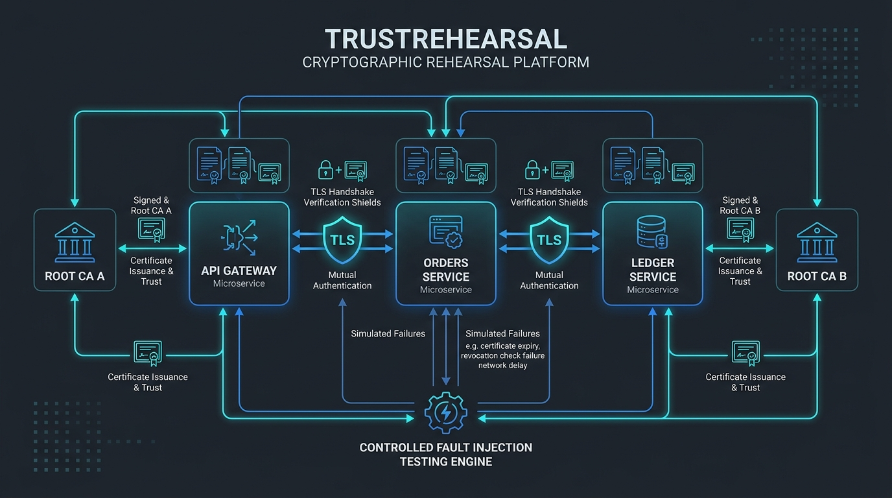
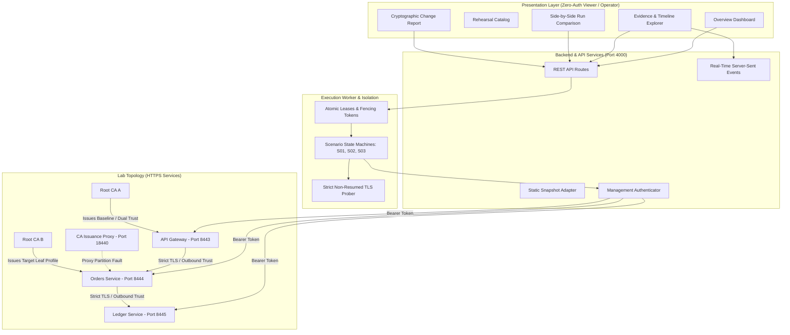
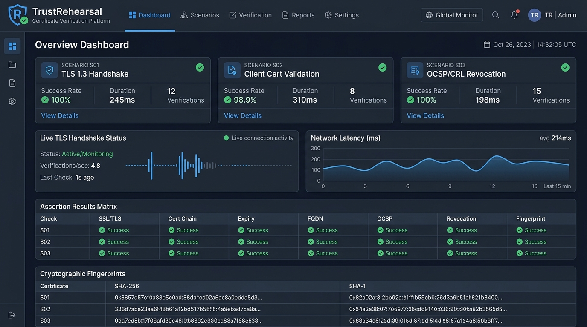
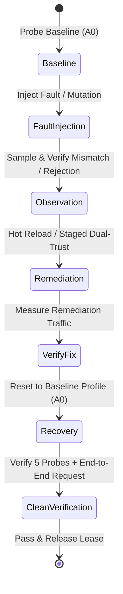

# TrustRehearsal

**Rehearse cryptographic change. See what breaks before production.**

TrustRehearsal is an automated resilience platform that tests certificate renewals, CA outages, and trust-root migrations against live running microservices. Rather than relying on simulated timers or synthetic mocks, every measurement is captured via fresh, non-resumed TLS handshakes with strict hostname and certificate chain validation.



---

## Key Highlights

- **Zero-Setup Executive Explorer**: Opens directly to an intuitive overview with **no login, no password, and no sign-in barrier**. Anyone can select scenarios, explore verified runs, inspect TLS evidence, compare compatible executions, and download audit-ready reports.
- **Real TLS Verification**: Every probe opens a real, fresh socket against HTTPS microservices (`gateway → orders → ledger`) enforcing SNI, SAN checks, and caller trust bundles.
- **Strict Verification of Recovery**: Rehearsals only pass if post-recovery probing confirms expected baseline fingerprints and successful end-to-end multi-hop application requests.
- **Failures Distinguished from Outages**: Clean separation between intentional TLS assertion rejections and service health.

---

## System Architecture

TrustRehearsal consists of a modern React/Vite frontend, a durable Node.js/Express execution backend, MongoDB persistence, and a dedicated PKI lab topology.



### The Real Application Trust Path

Application requests travel end-to-end:
$$\text{Caller (Client)} \longrightarrow \text{API Gateway} \xrightarrow[\text{Strict SNI + Trust A}]{\text{Mutual TLS}} \text{Orders Service} \xrightarrow[\text{Strict SNI + Trust A}]{\text{Mutual TLS}} \text{Ledger Service}$$

- Each service maintains its **own configured outbound trust bundle** on disk.
- If the `orders` trust bundle is left stale during a root rollover, application requests fail at the `orders → ledger` hop even if an external prober succeeds.
- Every run captures real `sample_request` events confirming actual end-to-end data transfer.

---

## Executive & Stakeholder Dashboard



### Core Features

1. **Rehearsal Catalog (`/rehearsals`)**:
   - Structured runbooks for **S01** (Certificate Reload), **S02** (Issuance Path Unavailability), and **S03** (Trust-Root Rollover).
   - Clear indicators of mutation phases, duration limits, and expected failure modes.
2. **Evidence Timeline (`/runs/:id`)**:
   - Inspect individual TLS probe events, latency metrics (+elapsed ms), and raw SHA-256 certificate fingerprints.
   - Filter events by type (`tls_probe`, `sample_request`, `phase_started`, `fault_enabled`, `recovery_verified`).
3. **Run Comparison Matrix (`/compare`)**:
   - Side-by-side assertion comparison across rehearsal runs.
   - Automatic incompatibility detection when comparing different scenarios.
   - Evaluates actual observed values (e.g. fingerprint hashes, error codes) rather than simple pass/fail status.
4. **Audit Reports (`/runs/:id/report`)**:
   - Canonical cryptographic change reports ready for print (A4-optimized) or formatted JSON download.

---

## Rehearsal Scenarios



### S01 — Renewal Without Application Reload
- **Objective**: Detects the silent failure where an automated cert-bot writes a renewed leaf certificate to disk (`profile A1`), but the running service continues serving the stale in-memory certificate (`profile A0`).
- **Observation**: Proves mismatch between on-disk certificate fingerprint and the served TLS handshake certificate.
- **Recovery**: Triggers in-memory TLS context reload via loopback management API without terminating the process or dropping connections.

### S02 — Issuance-Path Unavailability
- **Objective**: Proves that a network partition or proxy failure on the CA route does not disrupt data-plane traffic for services with currently valid certificates.
- **Observation**: Simulates network partition against the CA issuance proxy (HTTP 502 Bad Gateway). Verifies background renewals fail predictably while data-plane client handshakes remain 100% operational.
- **Recovery**: Clears proxy partition, confirms successful issuance retry, and verifies baseline state.

### S03 — Trust-Root Rollover
- **Objective**: Compares abrupt root replacement against a staged dual-trust rollover sequence.
- **Negative Control**: Abruptly serves a `Root B` certificate to callers configured only with `Root A` trust. Proves strict TLS rejection (`UNABLE_TO_VERIFY_LEAF_SIGNATURE`).
- **Staged Migration**:
  1. Install dual-trust bundle (`Root A + Root B`) across callers.
  2. Switch leaf certificate to `Root B`. Data-plane succeeds seamlessly.
  3. Prune `Root A` from callers, completing migration to `Root B`.
  4. Verify clean baseline recovery.

---

## Getting Started

### Prerequisites

- **Node.js**: `v22.x` or newer
- **npm**: `v10.x` or newer
- **MongoDB**: `127.0.0.1:27017` (required for local operator runs; not needed for the static viewer)

### Installation

```bash
# Clone the repository
git clone https://github.com/your-org/TrustRehearsal.git
cd TrustRehearsal

# Install workspace dependencies
npm install

# Setup environment configuration
cp .env.example .env
```

---

## Running the Application

### Option 1: Standalone Public Viewer (Zero Credentials / Zero Setup)

To explore pre-recorded canonical rehearsal runs without running MongoDB or backend processes:

```bash
# Start frontend preview
npm run dev:frontend
```

Open `http://localhost:5173` in any browser. The application automatically loads canonical reports from `public/data/snapshots.json`.

### Option 2: Full Local Lab (Live Execution)

To run live cryptographic experiments and test dynamic reloading:

```bash
# Start both backend and frontend concurrently
npm run dev
```

- **Frontend Dashboard**: `http://localhost:5173`
- **Backend API**: `http://localhost:4000`
- **Gateway HTTPS Service**: `https://localhost:8443`
- **Orders HTTPS Service**: `https://localhost:8444`
- **Ledger HTTPS Service**: `https://localhost:8445`
- **CA Issuance Proxy**: `http://127.0.0.1:18440`

---

## Operational Commands

| Command | Description |
|---|---|
| `npm run dev` | Starts backend server and frontend development server concurrently. |
| `npm run lab:verify` | Non-destructive health check testing live TLS connectivity across gateway, orders, and ledger. |
| `npm run lab:reset` | Restores database leases and resets topology services to baseline `A0` profiles. |
| `npm run test` | Executes the complete test suite (24 tests across 6 files). |
| `npm run typecheck` | Validates TypeScript types across both `frontend` and `backend`. |
| `npm run build` | Compiles production assets and packages canonical snapshots into `dist/`. |

---

## Verification & Test Results

The platform includes automated regression coverage ensuring all safety boundaries and edge cases are enforced:

```
 RUN  v2.1.9 TrustRehearsal/backend

 ✓ tests/integration/repairs-regression.test.ts (9 tests)
   ✓ R01: Failed recovery cannot produce an overall pass and marks needs_reset
   ✓ R02: Zero samples cannot verify recovery
   ✓ R03: Cancellation halts subsequent experimental mutations
   ✓ R04: Unauthenticated internal management requests are rejected (401)
   ✓ R05: Stale fencing tokens and concurrent same-owner acquisitions are rejected
   ✓ R06: Interrupted worker runs are reconciled and baseline reset
   ✓ R07: Unknown Run and Scenario IDs return honest 404 Not Found
   ✓ R11: Transport failure (ECONNREFUSED) does not count as TLS certificate chain rejection
   ✓ R14: Incompatible scenario comparisons are detected and flagged
 ✓ tests/integration/runs-and-api.test.ts (2 tests)
   ✓ Executes durable S01 run, persists events, and generates valid report
   ✓ Enforces atomic fencing and rejects concurrent lease collision
 ✓ tests/integration/security-and-viewer.test.ts (5 tests)
   ✓ Enforces authenticated CSRF and origin validation
   ✓ Rejects anonymous mutations in viewer mode (403)
   ✓ Redacts private keys and secrets from exports
 ✓ tests/integration/scenarios-s02-s03.test.ts (3 tests)
   ✓ S02 CA proxy partition simulation
   ✓ S03 staged dual-trust rollover and negative control
   ✓ Consecutive repetitions with baseline verification
 ✓ tests/tls-proof.test.ts (2 tests)
   ✓ Strict hostname and SAN verification proof
 ✓ tests/contracts.test.ts (3 tests)
   ✓ Zod schema validation against canonical reports

Test Files  6 passed (6)
     Tests  24 passed (24)
```

In addition, the external reproduction harness (`reproduce.cjs`) validates that:
- Failed recovery marks `needs_reset`.
- Cancellation immediately stops further mutations.
- Unauthenticated management requests return `401 UNAUTHORIZED_MANAGEMENT`.
- Live reports contain verifiable `sample_request` events and non-empty evidence arrays.

---

## Security Boundaries & Honest Claims

1. **Viewer Boundary**: The public viewer mode disables all state-changing endpoints (`403 LIVE_DISABLED`) and operates with zero credentials or execution worker.
2. **Local Isolation**: Management endpoints (`/mgmt/*`) are restricted to internal loopback calls authenticated with bearer tokens. No arbitrary command execution or Docker socket mounting is permitted.
3. **Key Safety**: Private keys are held in memory or ephemeral lab directories. Private keys are **never stored in MongoDB**, exposed via the REST API, or exported in downloadable reports.
4. **Honest Language**: Rehearsal observations reflect sampled probe windows within the controlled lab environment. We explicitly state: *"Observed 0 failed fresh connections across 30 samples in this lab."* TrustRehearsal makes no claim of production certification or third-party warranty.

---

## License

MIT License. Designed and engineered for high-assurance cryptographic rehearsal.
